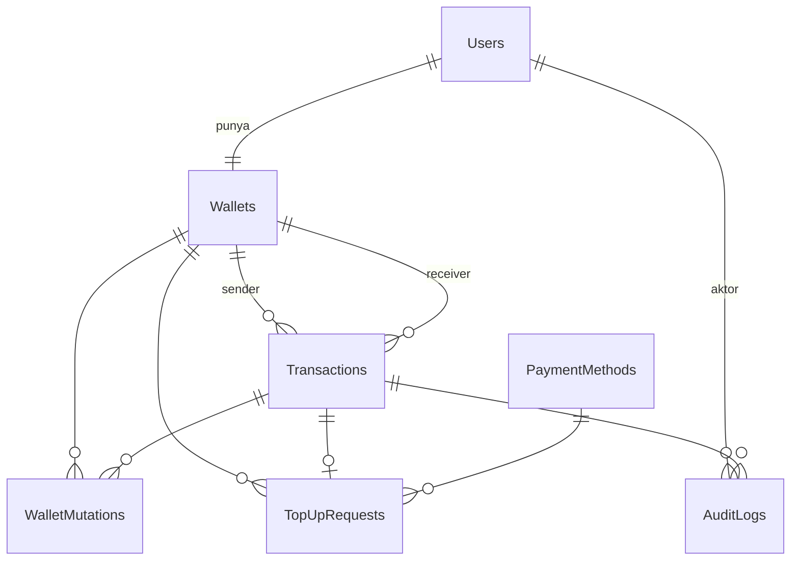
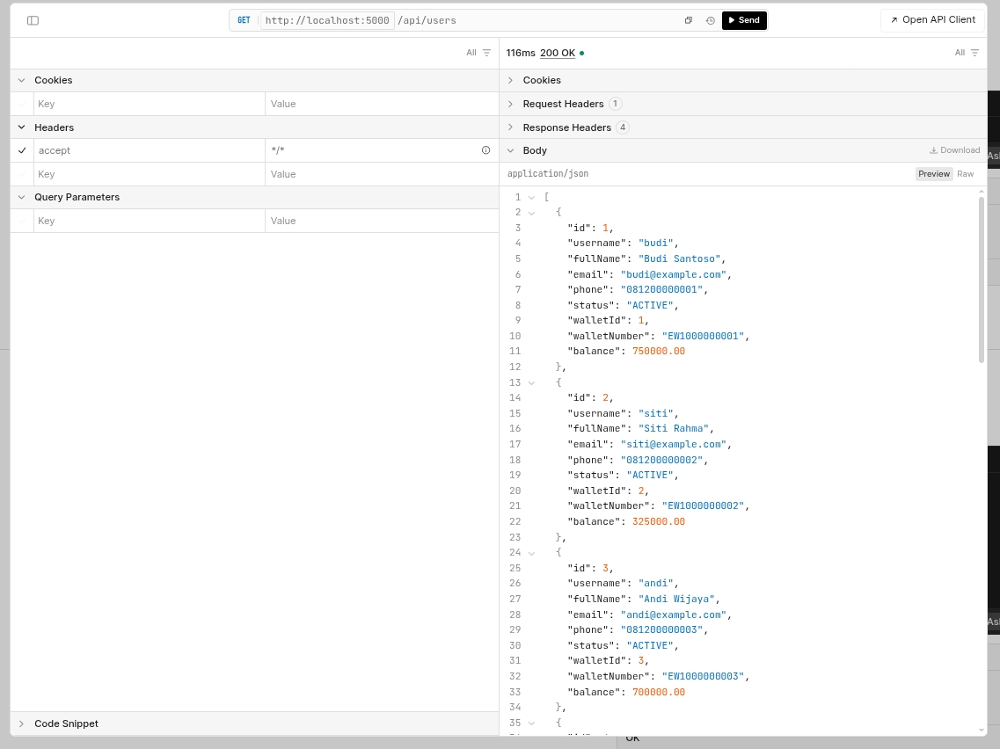
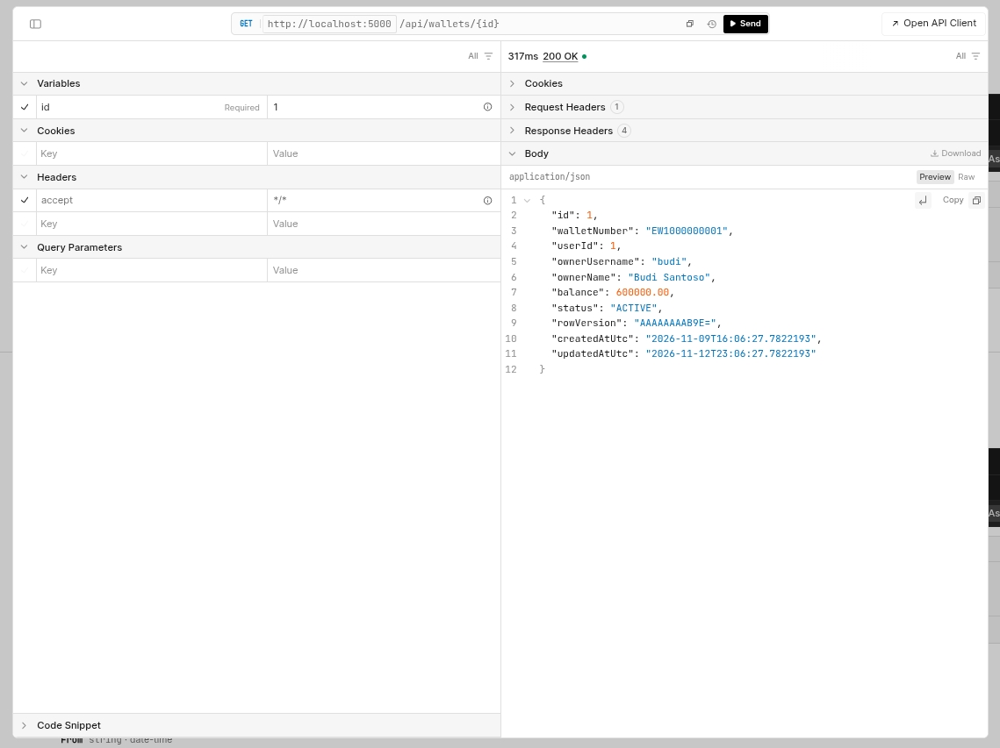
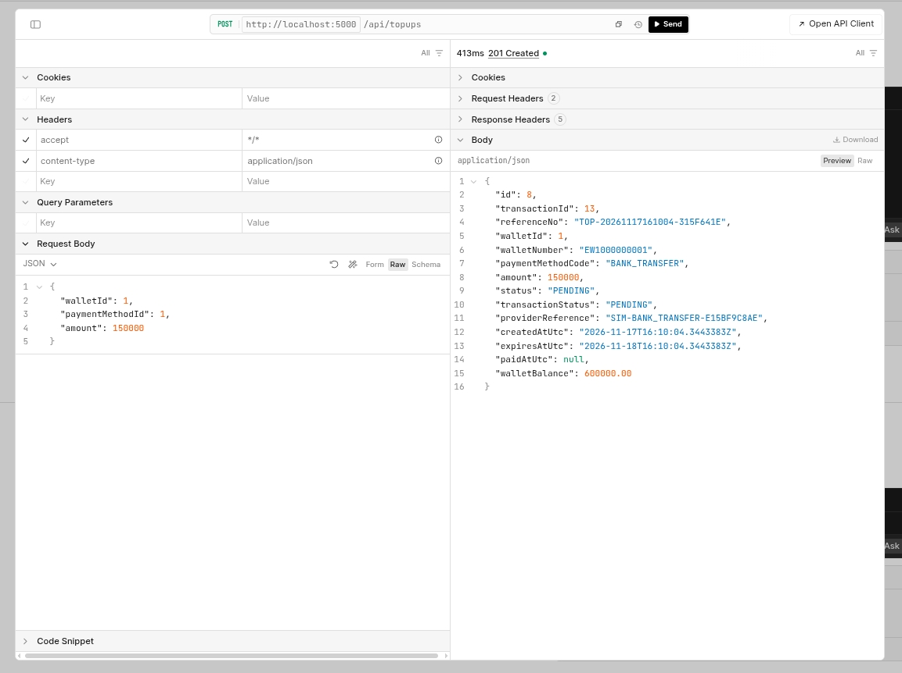
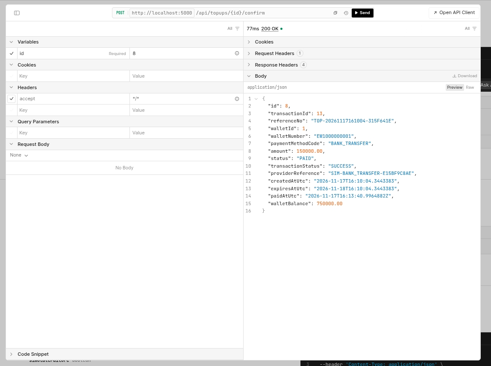
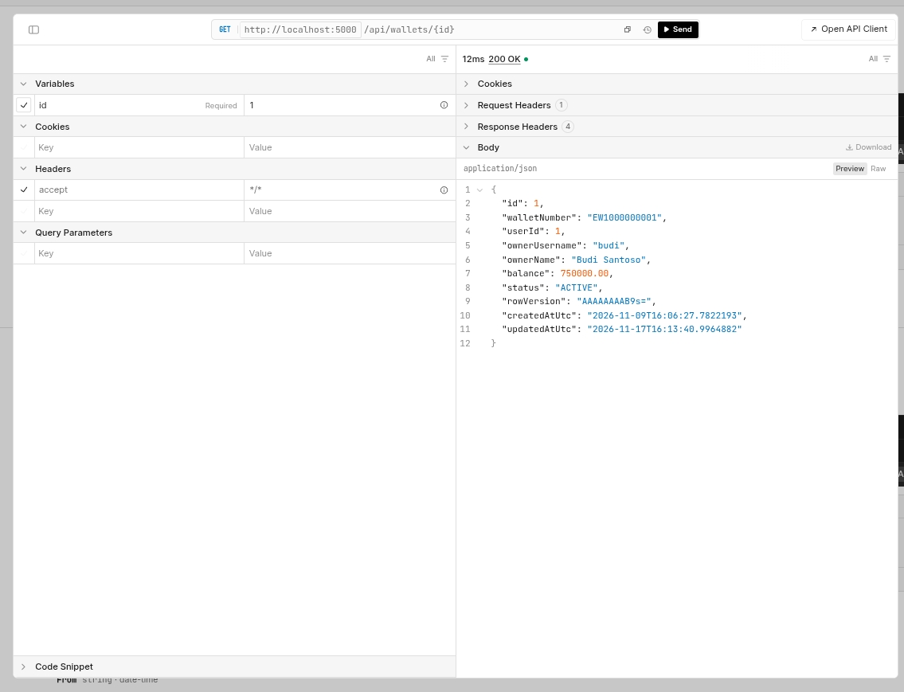
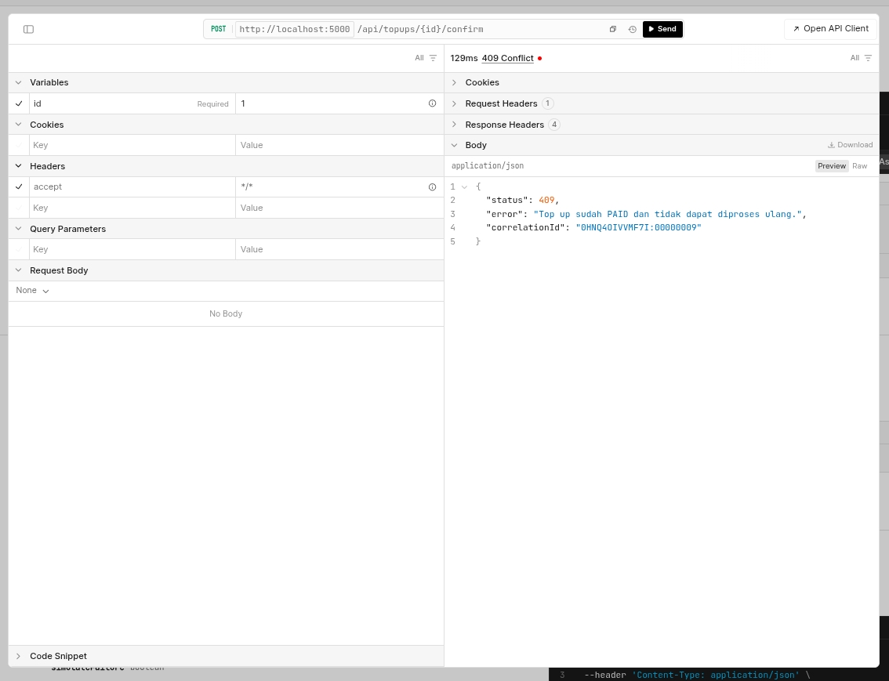
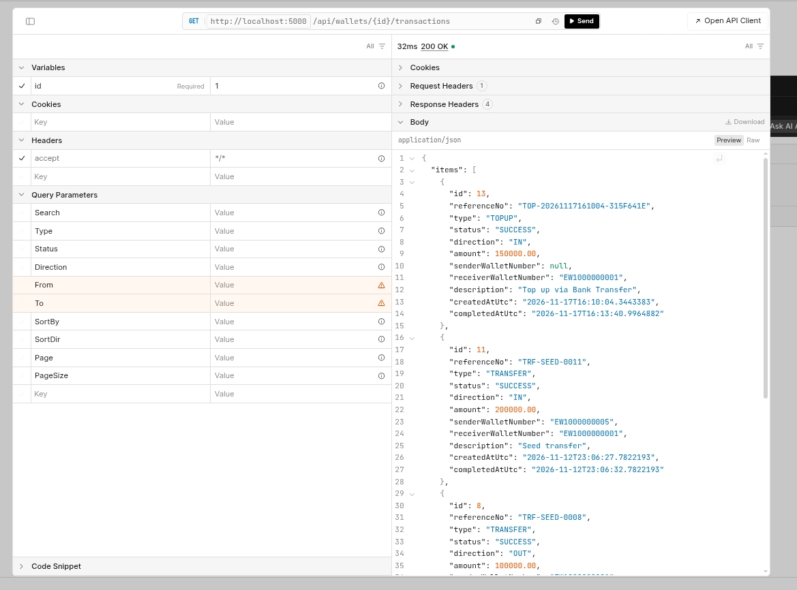
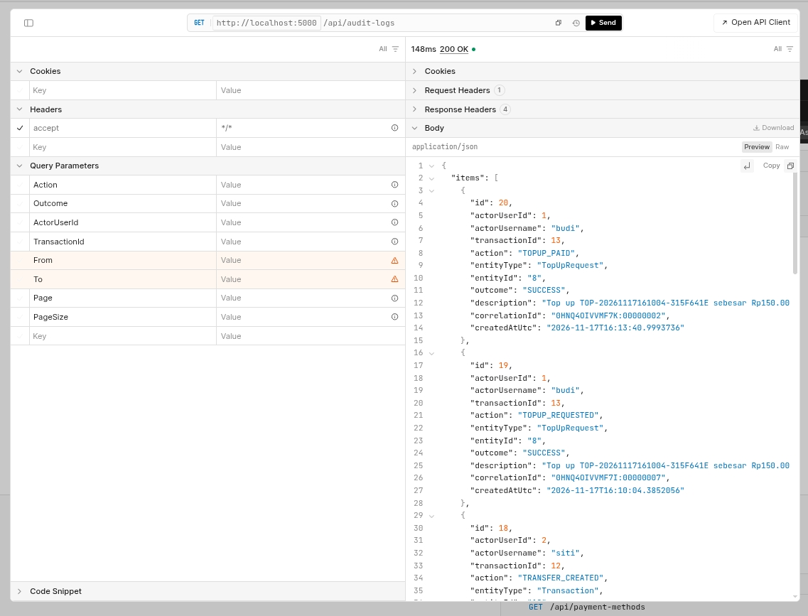

# E-Wallet API (Weekly 6)

Lanjutan project e-wallet dari weekly 5. Minggu ini data access-nya saya pindah dari ADO.NET ke EF Core, strukturnya masih sama (Controller, Service, Repository, DTO). Ditambah top up, payment method, mutasi wallet, sama audit log.

Pakai .NET 10, EF Core, SQL Server.

## Cara jalanin

1. Ubah connection string di `src/Ewallet/appsettings.json` sesuai SQL Server masing-masing.

2. Jalankan migration:

   ```bash
   cd src/Ewallet
   dotnet ef database update
   ```

3. Run:

   ```bash
   dotnet run
   ```

   Buka `http://localhost:5000/scalar` buat coba endpoint-nya. Contoh request juga ada di `src/Ewallet/Ewallet.http`.

### Seeding

Seeder jalan otomatis waktu app di-run di mode Development (sekalian migrate), tapi cuma kalau tabel Users masih kosong. Isinya:

- 10 user, masing-masing punya wallet (saldo awal 0)
- 3 payment method: Bank Transfer, QRIS, Credit Card
- beberapa top up dan transfer, saldo akhirnya dihitung dari transaksi yang sukses aja (1 top up sengaja dibiarkan PENDING)

Kalau mau seed ulang dari awal: `dotnet ef database drop -f` terus run lagi.

## Endpoint

```
GET    /api/users
GET    /api/users/{id}
POST   /api/users                    -> otomatis bikin wallet ACTIVE saldo 0
PUT    /api/users/{id}

GET    /api/wallets/{id}
GET    /api/wallets/{id}/transactions
GET    /api/wallets/{id}/mutations

GET    /api/payment-methods

POST   /api/topups                   -> status PENDING, saldo belum nambah
GET    /api/topups/{id}
POST   /api/topups/{id}/confirm      -> cuma bisa di Development

POST   /api/transfers

GET    /api/audit-logs
```

Histori transaksi & mutasi bisa pakai query: `search` (ReferenceNo), `type`, `status`, `direction`, `from`, `to`, `sortBy` (createdAt/amount), `sortDir`, `page`, `pageSize`.

Contoh: `/api/wallets/1/transactions?type=TRANSFER&direction=OUT&page=1&pageSize=5`

Buat ngetes rollback ada `POST /api/transfers?simulateFailure=true` (Development aja), dia sengaja error sebelum commit jadi saldonya harusnya ga berubah.

## ERD

ERD dari sini: https://github.com/AnggiJuhniawan/ERD-weekly-6



Constraint (unique, check, index) semuanya di-setting pakai Fluent API di folder `Data/Configurations`.

## Penjelasan singkat

**Transactions vs WalletMutations vs AuditLogs**

- Transactions: catatan transaksinya (top up / transfer), nominal, dari siapa ke siapa, statusnya.
- WalletMutations: perubahan saldo per wallet, ada saldo sebelum & sesudah. Jadi 1 transfer = 2 mutasi (OUT di pengirim, IN di penerima), top up = 1 mutasi.
- AuditLogs: log aktivitas, termasuk yang gagal/ditolak (misal transfer saldo kurang). Isinya cuma pesan umum, ga nyimpen data sensitif.

**AsNoTracking** dipakai di query yang cuma baca data (histori, list, dll) biar EF ga perlu tracking entity, jadi lebih ringan.

**Database transaction** dipakai waktu top up confirm dan transfer, karena yang diubah banyak tabel sekaligus (saldo, transaksi, mutasi, audit). Kalau ada yang gagal di tengah, semuanya di-rollback, jadi ga ada saldo yang berubah setengah-setengah.

**RowVersion** di tabel Wallets buat ngecek kalau ada 2 request yang ngubah saldo wallet yang sama barengan. Yang kalah bakal kena `DbUpdateConcurrencyException`, terus saya balikin 409 Conflict.

## Screenshot

List user



Saldo wallet budi sebelum top up (600.000)



Request top up 150.000, status masih PENDING dan saldo belum berubah



Setelah di-confirm, status jadi PAID / SUCCESS



Saldo sesudah top up jadi 750.000 (rowVersion juga berubah)



Confirm top up yang udah PAID -> 409



Histori transaksi wallet



Audit log


